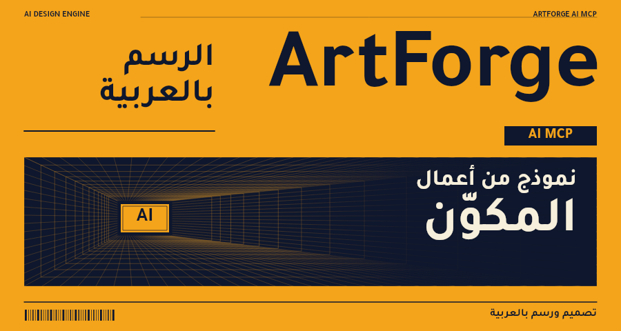
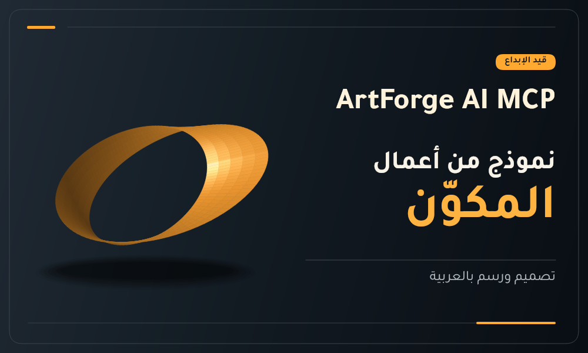
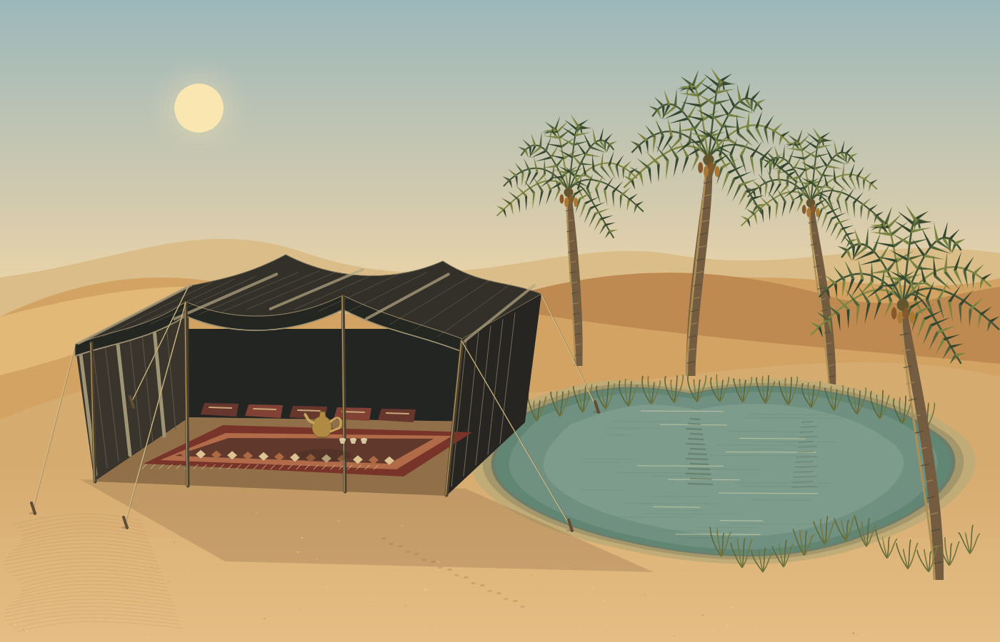
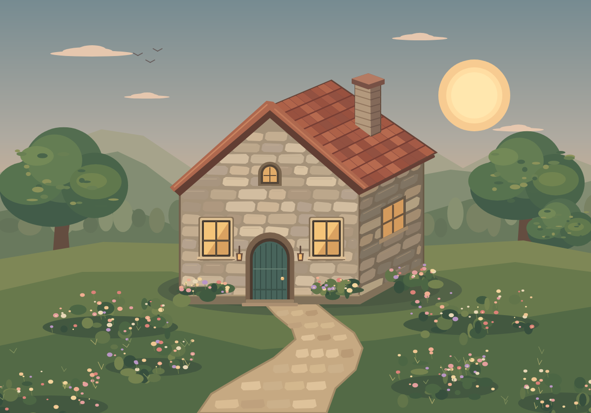

# ArtForge AI MCP

[](LICENSE)


**[العربية](#العربية) · [English](#english)**

<p align="center">
  
  
  
  
</p>
<p align="center"><sub>Sample works rendered by the ArtForge engine · نماذج من أعمال المكوّن</sub></p>

---

<div dir="rtl" align="right">

## العربية

**ArtForge AI MCP** محرّك رسم وتصميم ثنائي الأبعاد مفتوح المصدر، صُمّم للعربية أولًا، ويُتاح لوكلاء الذكاء الاصطناعي عبر بروتوكول MCP. مشروع من **مجموعة OBR Group الرقمية**.

### لماذا ArtForge؟

- **دعم أصيل للغة العربية**: تشكيل الحروف ووصلها، واتجاه من اليمين إلى اليسار مع عزل كل سطر عربي، ومحاذاة صحيحة لعلامات الترقيم، مع خطوط عربية مرفقة (أميري، تجوّل، المراعي).
- **جودة رسوم عالية**: عرض متجهي بمحرّك Skia مع تنعيم الحواف، وتدرجات لونية، وطبقات، وأنماط مزج، وظلال وتوهج، وفُرش رسم، وتصدير PNG وJPEG وWebP.
- **تصميم بأمر واحد**: يفهم الأداة `artforge_create_design` الطلب ويكتشف نوع التصميم (بطاقة، ملصق، جدول، صفحة مسطّرة، مشهد، شخصية…)، ثم يخطط ويرسم ويُصدّر ويفحص النتيجة بكسليًا ويعيد معاينة.
- **تعديلات دقيقة**: عمليات رسم أساسية (`draw.rect`، `draw.text`، `draw.path`، `draw.gradient`، `draw.brush`…) فرديًا أو دفعة واحدة.
- **آمن للاستضافة**: هذه النسخة تمنع الوصول لملفات المضيف ومزوّدي التوليد الخارجيين، وتحدّ الأبعاد بـ 1600 بكسل لكل ضلع، وتعالج طلبًا واحدًا في كل مرة.

### ربط المكوّن بأي وكيل

صفحة المطوّر ورابط الخادم المستضاف لربط المكوّن مباشرة بأي وكيل يدعم MCP:
**<https://obr.obr432.workers.dev/ai-plugins/#connect>**

أو شغّل الخادم محليًا كما يلي، ثم أضف العنوان `http://127.0.0.1:4273/mcp` إلى عميل MCP (نقل HTTP).

### التثبيت والتشغيل

المتطلبات: Node.js 20 أو أحدث (اختُبر على Node.js 24).

```sh
git clone https://github.com/duhbobaldo-oss/artforge-mcp-trial.git
cd artforge-mcp-trial
npm run setup      # يثبّت اعتمادية محرّك الرسم (@napi-rs/canvas)
npm start          # يبدأ الخادم على http://127.0.0.1:4273/mcp
npm test           # اختبار تشغيل شامل: تهيئة MCP، تصميم عربي، تصدير PNG، وقيود النسخة
```

- `GET /health` يعيد `{"ok":true}`.
- `POST /mcp` يستقبل رسالة JSON-RPC واحدة بترويسة `Content-Type: application/json` وبترميز UTF-8 (في سطر أوامر Windows احفظ الطلب في ملف UTF-8 وأرسله بـ `curl --data-binary @request.json` حتى لا يتحوّل النص العربي إلى مربعات فارغة).
- محليًا (`127.0.0.1`) لا يُطلب رمز. للربط على واجهة شبكة عامة يجب تقديم ملف رمز عبر `ARTFORGE_DEMO_TOKEN_FILE` (من 32 إلى 128 حرفًا من `A-Z a-z 0-9 _ -`)، ويرسل العميل `Authorization: Bearer <token>`.
- النشر عبر Docker وRender موضّح في [docs/trial-deployment.md](docs/trial-deployment.md).

### الأدوات المتاحة

| الأداة | الوظيفة |
|---|---|
| `artforge_create_design` | ينشئ تصميمًا كاملًا من وصف نصي ويعيد المعاينة ونتائج الفحص |
| `artforge_plan_design` / `artforge_execute_design` | تخطيط التصميم ثم تنفيذه على مرحلتين |
| `artforge_tool_op` | عمليات `draw.*` الأساسية، أو `batch` لعدة عمليات، وقراءة المستند ومعاينته |
| `artforge_export` | تصدير PNG أو JPEG أو WebP |
| `artforge_tool_docs` | إجراء التشغيل، ودليل المهارات، وتوجيه الطلب للمهارة المناسبة |
| `artforge_capabilities` / `artforge_status` / `artforge_artifacts` | القدرات والحالة والملفات الناتجة |
| `artforge_get_reference` / `artforge_book_knowledge` | لوحة الألوان ونظام التصميم المرفقان، والمعرفة المرجعية |

### بنية المستودع

| المسار | المحتوى |
|---|---|
| `server.js` | خادم HTTP لبروتوكول MCP، مع قيود الأمان والأبعاد |
| `artforge-mcp/` | وحدة MCP: التخطيط، وموجّه المهارات، والمهارات (`skills/`)، والجسر إلى محرّك الرسم |
| `drawing-tool/` | محرّك الرسم والخطوط العربية المرفقة وتراخيصها |
| `docs/` | توثيق العمليات والخطوط والتصدير والحدود ([docs/README.md](docs/README.md)) |
| `test/` | اختبار التشغيل الشامل |

### المساهمة والترخيص

نرحّب بالمساهمات؛ اقرأ [CONTRIBUTING.md](CONTRIBUTING.md). المشروع مرخّص بموجب [Apache License 2.0](LICENSE)، والخطوط المرفقة بموجب SIL Open Font License 1.1. التفاصيل في [THIRD_PARTY_NOTICES.md](THIRD_PARTY_NOTICES.md).

</div>

---

## English

**ArtForge AI MCP** is an open-source, Arabic-first 2D drawing and design engine that AI agents use through the Model Context Protocol (MCP). It is an **OBR Group** project.

### Highlights

- **Native Arabic support**: correct letter shaping and joining, right-to-left layout with per-line bidi isolation, proper punctuation placement, and bundled Arabic fonts (Amiri, Tajawal, Almarai).
- **High-quality graphics**: anti-aliased vector rendering on Skia, gradients, layers, blend modes, shadows and glows, brush strokes, and PNG / JPEG / WebP export.
- **One-call design**: `artforge_create_design` reads the request, detects the design type (card, poster, table, ruled page, scene, character, …), plans, draws, exports, runs pixel QA and returns a preview.
- **Precise edits**: primitive operations (`draw.rect`, `draw.text`, `draw.path`, `draw.gradient`, `draw.brush`, …) one at a time or as a batch.
- **Safe to host**: this distribution blocks host-file access and external generation providers, caps canvases at 1600 px per side, and serves one request at a time.

### Connect it to any agent

Developer page and hosted server URL for connecting ArtForge directly to any MCP-capable agent:
**<https://obr.obr432.workers.dev/ai-plugins/#connect>**

Or run the server locally (below) and add `http://127.0.0.1:4273/mcp` to your MCP client as an HTTP server.

### Install and run

Requirements: Node.js 20 or later (tested on Node.js 24).

```sh
git clone https://github.com/duhbobaldo-oss/artforge-mcp-trial.git
cd artforge-mcp-trial
npm run setup      # installs the drawing-engine dependency (@napi-rs/canvas)
npm start          # serves MCP at http://127.0.0.1:4273/mcp
npm test           # end-to-end smoke test: MCP handshake, Arabic design, PNG export, trial limits
```

- `GET /health` returns `{"ok":true}`.
- `POST /mcp` accepts one JSON-RPC message with `Content-Type: application/json`.
- On `127.0.0.1` no token is required. Binding to a public interface requires a token file via `ARTFORGE_DEMO_TOKEN_FILE` (32–128 characters of `A-Z a-z 0-9 _ -`); clients send `Authorization: Bearer <token>`.
- Environment variables: `HOST` (default `127.0.0.1`), `PORT` (default `4273`), `ARTFORGE_DEMO_TOKEN_FILE`.
- Docker and Render deployment: [docs/trial-deployment.md](docs/trial-deployment.md).

Example request:

```sh
curl -s http://127.0.0.1:4273/mcp -H "Content-Type: application/json" \
  -d '{"jsonrpc":"2.0","id":1,"method":"tools/call","params":{"name":"artforge_create_design","arguments":{"prompt":"بطاقة ترحيب","headline":"مرحبًا بالعربية","width":900,"height":480}}}'
```

> Requests must be UTF-8. On Windows shells, non-ASCII command-line arguments can be re-encoded and Arabic then renders as empty boxes; save the JSON to a UTF-8 file and send it with `curl --data-binary @request.json` instead.

### Tools

| Tool | Purpose |
|---|---|
| `artforge_create_design` | Build a complete design from a prompt; returns preview and QA results |
| `artforge_plan_design` / `artforge_execute_design` | Two-step plan, then execute |
| `artforge_tool_op` | Primitive `draw.*` operations, `batch`, document info and preview |
| `artforge_export` | Export PNG, JPEG or WebP |
| `artforge_tool_docs` | Operating procedure, skill guides and request routing |
| `artforge_capabilities` / `artforge_status` / `artforge_artifacts` | Capabilities, status and generated files |
| `artforge_get_reference` / `artforge_book_knowledge` | Bundled palette and design system, reference knowledge |

### Repository layout

| Path | Contents |
|---|---|
| `server.js` | HTTP MCP server with security and size limits |
| `artforge-mcp/` | MCP module: planner, skill router, skills (`skills/`), drawing-engine bridge |
| `drawing-tool/` | Drawing engine, bundled Arabic fonts and their licenses |
| `docs/` | Operations, fonts, export and limits documentation ([docs/README.md](docs/README.md)) |
| `test/` | End-to-end smoke test |

### Contributing and license

Contributions are welcome — see [CONTRIBUTING.md](CONTRIBUTING.md). Licensed under the [Apache License 2.0](LICENSE). Bundled fonts are under the SIL Open Font License 1.1; see [THIRD_PARTY_NOTICES.md](THIRD_PARTY_NOTICES.md).

© OBR Group
